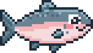

# Brand

Lax sees everything on your screen. That can feel unsettling, so the brand's job
is to make Lax feel like a calm, friendly companion, never like a camera.

## The idea

Salmon (*lax* in Swedish) travel out to sea and, years later, find their way back
to the exact river they were born in. Lax does the same with what you do on your
computer: it remembers where you've been, and it stays home.

## The mascot: a silver salmon

A salmon as it looks at sea, on its way home. Since October 2026 it is drawn as
pixel art everywhere: the app icon, the menu bar and the writing assistant (see
"The pixel salmon" below). The traits below hold for any new drawing:

- **Silver-blue, never orange.** Blue-grey back, a soft pink-white belly, a pink
  cheek.
- **Streamlined,** with a forked tail and the small adipose fin on the back that only
  salmon and their relatives have.
- **Swims forward,** facing right, towards where you're going.
- **A friendly cartoon eye** with a white and a highlight. Never a staring or watchful
  eye, and it never looks straight at the viewer.
- **Friendly shapes only.** No teeth, no sharp fins, even in pixels.
- **Moods:** awake (capturing), asleep with "zzz" (paused), waving (onboarding).

Lax is an alternative to apps like Goldfish, so it must never be mistaken for one:
no round orange fish.

### The pixel salmon

The salmon is pixel art, chosen by the maintainer on a designer's advice in
October 2026: in the app icon, in the menu bar and, small, when Lax comes to a
text field (the writing assistant). It is the
same fish in pixels: blue-grey back with darker spots, a soft pink belly, a pink
cheek, a white eye with a highlight and a small smile. It is drawn on a 38 × 22
grid and always shown at one point per pixel (`image-rendering: pixelated`), so
its edges stay crisp. Its palette: outline `#1F2C3C`, back `#8FB3BF`, `#698392`
and `#466A7A`, belly `#F5B3B5` and `#F5DBDC`, cheek `#F38D9B`, eye white
`#FEFEFE`.

While the model writes a draft, the pixel salmon shimmers through its colours and
bobs gently, so the user sees that it's working. With "Reduce motion" on, it
stays still.

## Colours

| Name | Hex | Use |
|---|---|---|
| Djupvatten (deep water) | `#0F2A33` | Text, outlines, dark backgrounds |
| Strömfåra (current) | `#2E6F73` | Primary buttons, links, accents |
| Ryggblå (back blue) | `#4F7F93` | The salmon's back and fins |
| Silversida (silver side) | `#C7D6DC` | The salmon's sides, borders |
| Älvsten (river stone) | `#EEF2F1` | Light backgrounds |
| Laxrosa (salmon pink) | `#E07A84` | Sparingly: the cheek, small highlights |

Text and backgrounds must meet WCAG contrast (4.5:1 for body text).

## Type

- **Bricolage Grotesque** for headings
- **Atkinson Hyperlegible** for body text, designed to be readable with low vision
- **JetBrains Mono** for data and code

All three use the SIL Open Font License. They are bundled with the app in
`src/fonts/` (sources, versions and licenses in `src/fonts/README.md`), never
loaded from Google Fonts at runtime (GUARDRAILS §7: no network requests). The
window's colours and fonts live in `src/styles.css`.

## Voice

Calm, concrete and honest. Say exactly what happens ("Paused until 14:15",
"Everything stays on this Mac"). No hype ("your AI-powered memory experience!") and
no reassurance without substance ("don't worry about privacy"). Only promise what
the code keeps, and point to [CLAIMS.md](CLAIMS.md).

## Icons

Every icon is drawn from an SVG source in the repository:

| Source | Becomes |
|---|---|
| `src-tauri/icons/app-icon.svg` | The app icon in every size (`icon.icns`, `icon.ico`, PNGs): the pixel salmon and two pixel bubbles on the light squircle |
| `src-tauri/icons/salmon.svg` | The pixel salmon, for the writing assistant's panel: see "The pixel salmon" above |
| `src-tauri/icons/tray/active.svg` | The menu bar icon while capturing: the pixel salmon's silhouette at half its grid, eye open |
| `src-tauri/icons/tray/paused.svg` | The menu bar icon while paused: a smaller, faded pixel salmon with pause bars |

After changing a source, run `npm run icons` and commit the result. The menu bar
icons are macOS template images: black on transparent, recoloured by macOS.
